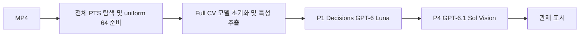
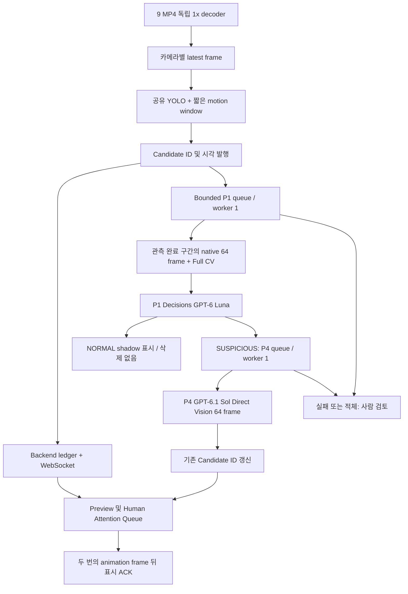

# 477 Fast Alert 런타임

기존 Frozen 실험과 별도인 로컬 단일 프로세스 MVP다. Fast CV 후보는 위험 확정이 아니다.
9개의 실제 MP4에서 만든 640×360 재생본을 1× 시간축으로 디코딩하며, 실제 프레임을 YOLO26n-pose와 움직임 차분에 입력한다.
모든 카메라의 재생 시작 기준은 모델 워밍업이 끝난 뒤의 공통 epoch다. 원본 30fps 디코딩, UI 최대 10fps, CV 목표 2fps는 서로 다른 지표다.

## 실행

현재 PC에서 검증한 서버 Python은 `D:\Users\suncastle\anaconda3\python.exe`이다.
Fast CV는 기존 `experiments/p0_cv_only/.venv/Scripts/python.exe`의 CUDA 환경을 별도 프로세스로 사용한다.
AI는 `D:/projects/477-backend/.venv/Scripts/python.exe`와 해당 저장소의 frozen adapter를 재사용한다.
FFmpeg/FFprobe와 nvidia-smi는 PATH에서 찾는다. `requirements.txt`는 서버 환경용이다.

```powershell
cd D:\projects\477
# API 비용 없이 실제 CV / 9개 MP4 / 사람 검토 표시
python -m runtime477.run --port 8011

# 또는 실제 P1/P4. 동시에 서버 2개를 같은 포트에 띄우지 않는다.
python -m runtime477.run --ai --max-ai-jobs 3 --port 8011 --env-file experiments/.env
```

브라우저에서 http://127.0.0.1:8011 을 열고 `1× 재생 시작`을 누른다.
워밍업 중에는 `WARMING_UP`, 실제 재생 중에는 `PLAYING`, 마지막 영상 종료 후에는 `FINISHED`다.
영상 종료 후에도 AI 작업은 계속된다. 다시 시연하려면 서버를 Ctrl+C로 종료 후 재시작한다.
브라우저 탭을 전면에 유지한다. 숨겨진 탭에는 paint ACK를 보내지 않아 실제 표시 지연이 커질 수 있다.
서버는 loopback에만 bind하며 `--workers 1`을 유지한다.

기존 React 프론트에서도 별도 진입점을 제공한다.

```powershell
cd D:\projects\477-frontend
node node_modules/vite/bin/vite.js --host 127.0.0.1 --port 5174
# 표시된 Vite 주소에 ?mode=live-replay 추가. 런타임 서버 8011을 먼저 실행한다.
```

http://127.0.0.1:5174/?mode=live-replay 는 Figma 기반 기존 React 디자인에 직접 연결된다. iframe을 사용하지 않는다.
기존 Header/로고/컬러 토큰/3×3 카메라 레이아웃/우측 카드 스타일을 재사용한다.
Vite의 `/runtime` HTTP·WebSocket 프록시가 8011 서버에 연결한다. 기존 `/api`, `/stream`, `/ws`의 8000 연결은 유지한다.
초기 후보 Preview와 사람 확인 대기열을 분리하며, 후보 클릭 시 원본 영상·실제 근거 프레임·AI 상태·관제사 확인/종결을 제공한다.
새 Attention Queue의 상태·Human 처리·Audit Log는 새 런타임 API가 관리한다. 기존 Incident DB에 자동 복제하는 구조는 아니다.
빌드 산출물을 별도 웹서버에 배포할 때는 `/runtime/*` → `127.0.0.1:8011/*` 역방향 프록시와 WebSocket upgrade를 동일하게 설정해야 한다.
`/`의 기존 시나리오 데모와 `?mode=live-replay`의 실제 CV 모드는 별도다.

환경 변수:

| 변수 | 용도 |
|---|---|
| OPENAI_API_KEY | `--ai`에서만 필요; 값은 로그에 출력하지 않음 |
| RUNTIME_BACKEND_ROOT | 기존 backend 저장소 경로 |
| RUNTIME_CV_PYTHON | CUDA/ultralytics interpreter 경로 |
| RUNTIME_AI_PYTHON | backend SDK interpreter 경로 |
| RUNTIME_AI | `1`이면 실제 API 활성화 (`--ai` 권장) |
| RUNTIME_MAX_AI_JOBS | 세션 전체 AI 제출 상한; 초과 후보는 사람 검토로 유지 |

`config.json`에 샘플링 FPS, 입력 해상도, 관측 임계값, 4회 연속 관측, 3초 merge gap,
큐 크기, AI timeout, 후보 저장 한도를 둔다. 임계값은 관측 후보 생성 설정이며 위험 판정 임계값이 아니다.
현재 첫 재검증 설정은 움직임 변화량 `0.015`(1.5%) 이상 × 4회 연속이다.
`sustain_samples`는 가로로 긴 사람 박스 신호에도 공통 적용된다.
기존 실행 로그에서 CAM_01·02·04만 움직임 후보가 되는 조합으로 선택했으며, 이 설정의 실제 9영상 재실행은 아직 미검증이다.
설정은 서버 시작 시 읽으므로 실행 중인 서버에는 자동 적용되지 않는다. 다음 재시연 전에 런타임 서버를 재시작한다.
카메라 매핑은 `CAM_01`~`CAM_09` → `data/mock_cctv/playback/CAM_XX.mp4`,
원본·AI 근거는 `data/mock_cctv/media/CAM_XX.mp4`다. 원본 파일명/라벨/GT는 모델 입력에 보내지 않는다.

## 실제 구현 구조

기존 경로:



새 경로:



Fast Path에는 64프레임, 전체 CV state, 모델 API 완료 의존성이 없다.
GPU 배치는 9개 크기로 고정하고 종료된 카메라 자리는 dummy로 채워 새 배치 형태의 cold kernel 지연을 피한다.
화면 전송은 WebSocket snapshot에 최신 JPEG를 넣는다. HTTP/1의 동시 MJPEG 연결 제한을 피하도록 UI에서 `/stream`을 사용하지 않는다.
화면 전체의 지속적 움직임 변화와 가로로 긴 사람 bbox만 후보 신호로 사용한다. 정교한 action/pose-transition 모델은 아니다.

AI Path는 보수적으로 기존 Full CV 및 Compact v1 serializer와 원래 P1 질문을 재사용한다.
P4는 **native RGB 기준 uniform 64 / lossless WebP**를 유지한다. 새 runtime sampler는 FFmpeg 단일 thread와 WebP worker 2개를 사용한다.
현재 시점까지 재생된 구간만 AI evidence에 사용하며 미래 프레임으로 판단을 앞당기지 않는다.
64→8/16 축소 실험은 수행하지 않았다. E1 v2/E2/E2.1과 Frozen 결과는 수정하지 않았다.

## 상태 및 보호 장치

- DETECTED/SCREENING/ANALYZING은 Preview, REQUIRES_REVIEW/ERROR/AI_DANGER_ESTIMATE는 Attention Queue에 둔다.
- AI_NORMAL_ESTIMATE도 보존한다. P1 NORMAL→SUPPRESS 계약은 shadow 기록이며 실제 suppression은 false다.
- 검증된 Direct DANGER 경로가 없어 Fast Alert를 DANGER로 만들지 않는다.
- 카메라·reason·coarse spatial zone별 merge. 다른 signal/zone 또는 3초 이상 관측 간격이면 새 ID다.
- 연속적인 동일 신호 내부의 독립 사건 구별은 미검증이며 정교한 tracking identity가 아니다.
- P1/P4 worker 각각 1개, queue 각각 2개. 제출 ID 중복 방지, 자동 재시도 0회, timeout 시 process tree 종료.
- 큐/세션 AI 상한 초과는 후보 삭제 없이 사람 검토. 비용·provider quota에 대한 무제한 재시도 없음.
- Human 처리 시 generation을 올린다. 늦은 AI 결과는 화면을 덮어쓰지 않고 stale audit로 남는다.
- `runs/<instance>/audit.jsonl`에 후보/판단/관측 변경을 append하고 근거 이미지와 provider의 정제된 결과를 별도 저장한다.
- 메모리 큐이므로 재시작 후 자동 job recovery는 없다. 세션 간 exactly-once 과금 보장은 하지 않는다.

## 시간 측정

T1/T2/T4/T5는 서버·worker epoch 초다. 영상 PTS는 워밍업 종료 epoch와 정렬한다.
T3는 브라우저가 카메라 강조/후보 DOM을 갱신하고 requestAnimationFrame 두 번 뒤 보내는 ACK다.
5회 `/api/time` 중 최소 RTT 표본으로 시계를 보정하고 RTT/2를 불확실성으로 기록한다.
화면 광학 계측이나 모든 카드의 viewport 내 노출 시각은 아니며 브라우저 paint 기회 이후의 계측이다.
T0는 사람 주석이 없으므로 null이며 T1을 T0로 대체하지 않는다.

독립 Human Annotation을 확보한 뒤에만 다음을 실행한다. 추론 입력에는 사용하지 않는다.

```powershell
python -m runtime477.annotate runtime477/runs/<instance> human-annotations.json
```

주석 형태: `[{"candidate_id":"cand_...","t0_video_sec":1.2,"annotator":"human","uncertainty_sec":0.1}]`.
숫자는 예시이며 실제 주석이 아니다. timestamp는 해당 playback PTS 기준이다.

## 저장 결과 모드

`config.json`의 mode를 `RECORDED_RESULT_DEMO_MODE`로, recorded_results를 JSON 경로로 지정하면
실제 CV가 생성한 후보의 camera/PTS와 일치하는 저장 결과를 detail에 표시한다. 이 모드는 API를 강제로 비활성화한다.
결과 형식은 `[{"camera_id":"CAM_04","start_pts":0,"end_pts":6,"assessment":{...}}]`다.
일치하는 저장 결과가 없으면 `NO_RECORDED_RESULT`로 사람 검토에 남는다.
사전 탐지 시각 재생 기능은 없고, 저장 결과의 API latency도 실시간 실적으로 집계하지 않는다.
이 모드의 실제 저장 결과를 사용한 end-to-end 시연은 아직 검증하지 않았다.

## 검증

```powershell
python -m pytest runtime477/tests -q
python -m runtime477.verify_camera_isolation
```

실제 측정·제한과 최종 준비 상태는 `REPORT.ko.md`를 참조한다.
